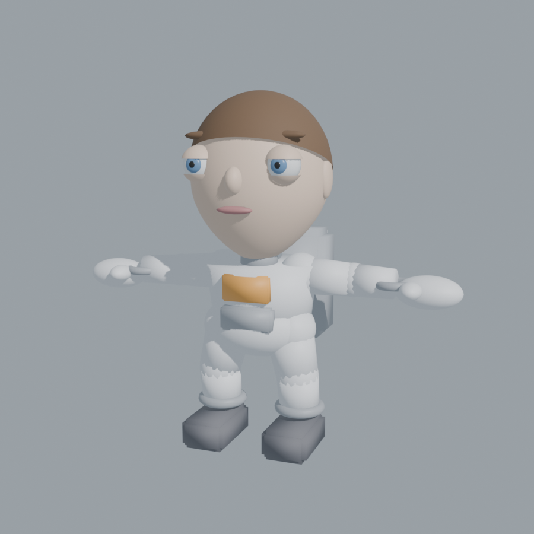
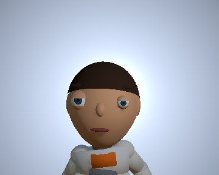
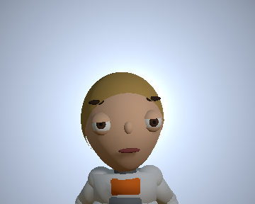
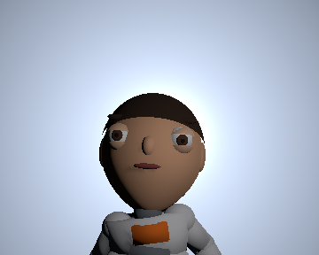
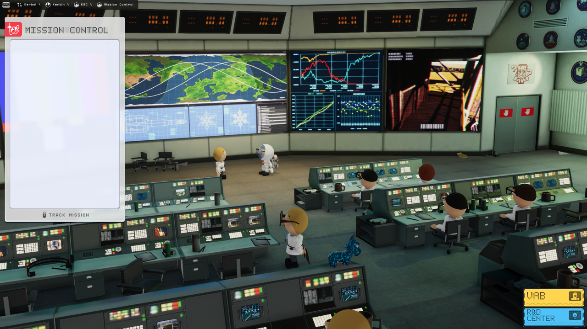

# Humble Space Program (HSP): the KSP2 Redux mod that makes the kerbals human

Makes the inhabitants of Kerbal Space Program 2 Redux human and calls them Gerbals: 3D models,
textures, hair and eyes, names, Gerbal narration, and body sound effects. Targets the Redux install on this machine
(0.2.9.0 beta, channel `beta`, engine Unity 6000.5.8f1, Wwise 2021.1.10).

Current state (2026-09-03): Phase 1 milestone reached. The mod builds, installs, and the game
renders human astronauts for every roster kerbal using the generated placeholder models:

| Blender source | In-game portrait (Jeb) | In-game portrait (Valentina) | In-game portrait (Lubree) |
| --- | --- | --- | --- |
|  |  |  |  |

The mod is installed for testing at `<KSP2>\mods\__Testing\HumbleSpaceProgram` (rebuild with
`tools\unity_batch.ps1 -Method HumbleSpaceProgramBatch.BuildForPlayer`); `unity\Deploy\HumbleSpaceProgram.zip`
is the distributable build.

Mission Control and the main-menu vignettes use pre-built kerbal actor prefabs that bypass the
roster pipeline; since 2026-09-03 `Code/ActorPatches.cs` converts them at spawn (human lab-coat and
jumpsuit placeholder bodies included). The stock `LoadingScreens` configuration is also redirected
to the bundled human launch artwork, covering every KSC, Mission Control, VAB, recovery, crash, and
tutorial loading-screen key. Startup splash animations and the first-run orientation film are skipped.
Normal launches load the most recently modified autosave (`Metadata.SavedGameType = Auto`) across
single-player campaigns, then enter Mission Control. With no autosave, the main menu remains available;
a failed load cancels the Mission Control transition. Pass `-humblespaceprogram-menu` to start at the
menu explicitly. Existing automated test modes retain their own loading behavior.

Room actors and EVA humans use adult proportions (standing height approximately 1.73 m), with the
scale reapplied after animation so stock clips cannot reset it. IVA and portrait models use the same
proportions scaled to fit their fixed seats and camera framing.
Verify the room actors with `tools\verify_in_game.ps1 -MissionControl`,
which saves screenshots to `logs\missioncontrol`:



Sound (since 2026-09-04): every kerbal sound event is renamed by rule, Kerbal -> Gerbal, so a mod
soundbank authored with `Play_An_Gerbal_*` names replaces the stock events automatically (events the
bank lacks stay stock), and the English narration lines that say "Kerbal" now say "Gerbal": the
narrator's own recordings, re-cut by `tools/vo_gerbal.py` and shipped in a soundbank that
`tools/wwise_bank_write.py` generates without the Wwise authoring tool. Check with
`tools\verify_in_game.ps1 -AudioTest`.

Start with `docs/PLAN.md`. It holds the findings from the game teardown, the architecture, the
phased delivery plan and the tool install list. `docs/game-reference.md` is the technical contract
the new assets must follow (rig, bone names, materials, addressable keys). `docs/audio-events.md`
lists every kerbal sound event with its Wwise ID.

## Layout

| Path | What |
| --- | --- |
| `docs/` | Plan, game reference, audio event table |
| `mod/HumbleSpaceProgram/` | Mod content: `swinfo.json`, C# code, data tables, localization, soundbank slot, patches |
| `tools/` | Python scripts that read the game's Addressables catalog, bundles and Wwise banks |
| `reference/` | Extracted stock meshes, textures, materials, rig hierarchies and clip list (git-ignored, local only) |
| `unity/` | The Unity project the Redux SDK Manager generates (template 26w35b, Unity 6000.5.8f1; the imported game and caches are regenerated locally, see "Version control") |

## Quick start

```powershell
# 1. Refresh reference assets from the game install (Python 3.11 is on this machine)
tools\venv\Scripts\python tools\extract_reference.py

# 2. The Unity project already exists in unity\ (template 26w35b, Unity 6000.5.8f1). After signing
#    in to Unity Hub once (license), import the game and create the mod headless:
tools\sdk\redux-sdk-cli.exe setup --ksp2 "C:\Program Files (x86)\Steam\steamapps\common\Kerbal Space Program 2\KSP2_x64.exe" unity
powershell -File tools\unity_batch.ps1 -Method HumbleSpaceProgramBatch.SetupMod
powershell -File tools\unity_batch.ps1 -Method HumbleSpaceProgramBatch.BuildForPlayer   # -> <KSP2>\mods\__Testing\HumbleSpaceProgram
powershell -File tools\unity_batch.ps1 -Method HumbleSpaceProgramBatch.Deploy           # -> unity\Deploy\HumbleSpaceProgram.zip

# 3. Blender reference scene with the kerbal armature and stock meshes:
blender --background --python tools\blender_build_rig.py -- reference blender\kerbal_rig.blend
```

Source of truth for the plugin code is `mod\HumbleSpaceProgram\Code`; `unity\Staging\Code` is the copy the
headless SetupMod step installs into the Unity project.

Stock game assets extracted into `reference/` are for study and scale matching only and must never
ship inside the mod.

## Version control

The repository holds everything needed to rebuild the mod: `mod/`, `tools/` (scripts and the Redux
SDK CLI), `docs/`, `blender/*.blend` and the Unity project in `unity/` (the mod's assets, code,
addressable groups, editor scripts and project settings). Large binaries (`.exe`, `.bnk`, `.mp4`,
`.blend`, `.fbx`, textures under `unity/Assets`) are stored with Git LFS, so run `git lfs install`
once per machine before cloning.

Not tracked, regenerate locally after a clone:

| Path | How to recreate |
| --- | --- |
| `reference/` (extracted stock meshes, textures, audio, video) | `tools\venv\Scripts\python tools\extract_reference.py`, `tools\vo_transcribe.py` |
| `tools/venv/` | `python -m venv tools\venv` then `pip install -r tools\requirements.txt` |
| `tools/vgmstream/`, `tools/wwiser/` | Download from github.com/vgmstream/vgmstream and github.com/bnnm/wwiser (releases) |
| `unity/Packages/KSP2_x64/`, `unity/Assets/StreamingAssets/`, `unity/Redux/`, `unity/Library/` | `tools\sdk\redux-sdk-cli.exe setup --ksp2 <KSP2_x64.exe> unity` (imports the game) |
| `unity/Deploy/`, `<KSP2>\mods\__Testing\HumbleSpaceProgram` | `tools\unity_batch.ps1 -Method HumbleSpaceProgramBatch.BuildForPlayer` / `Deploy` |
| `logs/` | Written by the batch and verification scripts |

Unity project folders at the repository root (`Assets`, `Library`, `Packages`, `ProjectSettings`,
`UserSettings`) are ignored as a guard: an early Unity license check once opened the root as a
project and left them behind. The real project is `unity/`.
